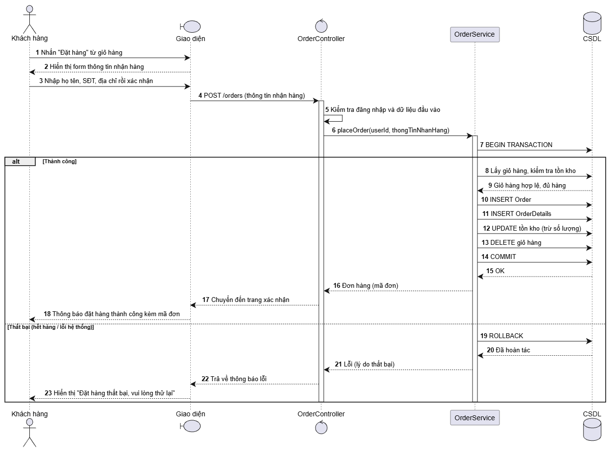

# Biểu đồ tuần tự (Sequence Diagram) - Luồng Đặt hàng

## 1. Sơ đồ

## 2. Mô tả luồng hoạt động

Sơ đồ mô tả quá trình Khách hàng thực hiện đặt hàng trên hệ thống, đảm bảo tính toàn vẹn dữ liệu thông qua việc sử dụng **Transaction** (theo yêu cầu TM-NFR1).

### Các thành phần tham gia:
- **Khách hàng:** Người tương tác với giao diện.
- **Giao diện (React):** Hiển thị form và gửi yêu cầu.
- **OrderController:** Tiếp nhận request, kiểm tra dữ liệu đầu vào (validation).
- **OrderService:** Xử lý logic nghiệp vụ chính (kiểm tra kho, tính toán).
- **CSDL (MySQL):** Lưu trữ dữ liệu (Orders, Order_Items, Products, Cart_Items).

### Luồng chính (Thành công):
1. Khách hàng nhấn "Đặt hàng" trên giao diện.
2. Giao diện gửi request `POST /api/orders` (kèm thông tin giao hàng) đến Controller.
3. Controller kiểm tra dữ liệu hợp lệ, sau đó gọi hàm `placeOrder()` của OrderService.
4. **OrderService bắt đầu Transaction (BEGIN TRANSACTION).** *(Điểm quan trọng nhất)*
5. Service kiểm tra tồn kho của từng sản phẩm trong giỏ.
6. Nếu đủ hàng, Service thực hiện chuỗi lệnh:
   - `INSERT` vào bảng `orders` (tạo đơn hàng mới).
   - `INSERT` vào bảng `order_details` (lưu lại giá tại thời điểm mua).
   - `UPDATE` bảng `products` (trừ đi số lượng tồn kho).
   - `DELETE` bảng `cart_items` (xóa giỏ hàng của khách).
7. **Service COMMIT Transaction** để lưu thay đổi vào CSDL.
8. Controller trả về HTTP 201 (Thành công), giao diện chuyển hướng sang trang "Đơn hàng của tôi".

### Luồng ngoại lệ (Thất bại / Hết hàng):
- Nếu bước 5 phát hiện có sản phẩm không đủ tồn kho, hoặc có bất kỳ lỗi hệ thống nào xảy ra trong quá trình ghi dữ liệu:
- Service sẽ gọi lệnh **ROLLBACK Transaction** để hủy bỏ toàn bộ các thay đổi vừa thực hiện (đảm bảo không bị trừ kho ảo, không tạo đơn rác).
- Hệ thống trả về thông báo lỗi cho Khách hàng (VD: "Sản phẩm X không đủ hàng, vui lòng điều chỉnh lại giỏ hàng").