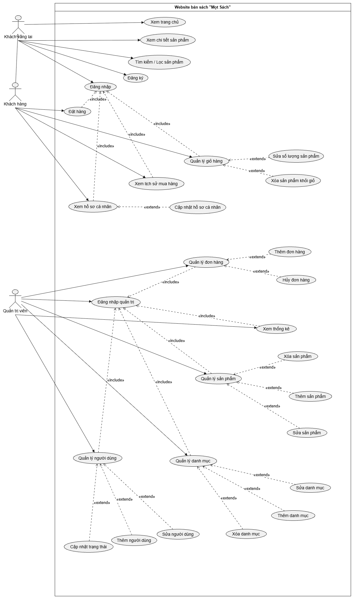

# ĐẶC TẢ USE CASE - WEBSITE BÁN SÁCH "MỌT SÁCH"

## 0. Sơ đồ Use Case

## 1. Danh sách tác nhân

| Tác nhân | Mô tả |
|---|---|
| Khách vãng lai (Guest) | Người truy cập website khi chưa đăng nhập. Được xem, tìm kiếm, lọc sản phẩm, đăng ký và đăng nhập. |
| Khách hàng (Customer) | Người dùng đã có tài khoản. **Kế thừa** toàn bộ chức năng của Khách vãng lai, ngoài ra có các chức năng mua hàng và quản lý tài khoản. |
| Quản trị viên (Admin) | Người quản lý hệ thống, phải đăng nhập quản trị mới vào được trang quản trị. |

## 2. Danh sách use case

| Mã | Tên use case | Tác nhân | Quan hệ |
|---|---|---|---|
| G1 | Xem trang chủ | Guest | |
| G2 | Xem chi tiết sản phẩm | Guest | |
| G3 | Tìm kiếm / Lọc sản phẩm | Guest | |
| G4 | Đăng ký | Guest | |
| G5 | Đăng nhập | Guest | Được C1, C2, C3, C4 include |
| C1 | Quản lý giỏ hàng | Customer | Include G5. Extend: C1a Sửa số lượng sản phẩm, C1b Xóa sản phẩm khỏi giỏ |
| C2 | Đặt hàng | Customer | Include G5 |
| C3 | Xem lịch sử mua hàng | Customer | Include G5 |
| C4 | Xem hồ sơ cá nhân | Customer | Include G5. Extend: C4a Cập nhật hồ sơ cá nhân |
| A0 | Đăng nhập quản trị | Admin | Được A1 đến A5 include |
| A1 | Quản lý đơn hàng | Admin | Include A0. Extend: A1a Thêm đơn hàng, A1b Hủy đơn hàng |
| A2 | Quản lý sản phẩm | Admin | Include A0. Extend: A2a Thêm, A2b Sửa, A2c Xóa sản phẩm |
| A3 | Quản lý danh mục | Admin | Include A0. Extend: A3a Thêm, A3b Sửa, A3c Xóa danh mục |
| A4 | Xem thống kê | Admin | Include A0 |
| A5 | Quản lý người dùng | Admin | Include A0. Extend: A5a Thêm, A5b Sửa, A5c Cập nhật trạng thái |

---

## 3. Đặc tả chi tiết

### 3.1. Nhóm chức năng của Khách vãng lai

#### G1. Xem trang chủ

| Mục | Nội dung |
|---|---|
| Tác nhân | Khách vãng lai, Khách hàng |
| Mô tả | Hiển thị trang chủ của cửa hàng với sách nổi bật, sách mới, danh mục. |
| Tiền điều kiện | Truy cập được website. |
| Hậu điều kiện | Trang chủ được hiển thị đầy đủ. |
| Luồng chính | 1. Người dùng truy cập địa chỉ website. 2. Hệ thống lấy dữ liệu sách nổi bật, sách mới và danh mục. 3. Hệ thống hiển thị trang chủ. |
| Luồng thay thế | 2a. Không tải được dữ liệu: hệ thống hiển thị thông báo lỗi và cho phép tải lại trang. |

#### G2. Xem chi tiết sản phẩm

| Mục | Nội dung |
|---|---|
| Tác nhân | Khách vãng lai, Khách hàng |
| Mô tả | Xem thông tin đầy đủ của một cuốn sách (tên, tác giả, giá, mô tả, hình ảnh, tình trạng còn hàng). |
| Tiền điều kiện | Sản phẩm tồn tại và đang được bán. |
| Hậu điều kiện | Trang chi tiết sản phẩm được hiển thị. |
| Luồng chính | 1. Người dùng chọn một sản phẩm từ trang chủ hoặc kết quả tìm kiếm. 2. Hệ thống truy vấn thông tin sản phẩm. 3. Hệ thống hiển thị trang chi tiết. |
| Luồng thay thế | 2a. Sản phẩm không tồn tại hoặc đã bị xóa: hệ thống báo "Không tìm thấy sản phẩm". |

#### G3. Tìm kiếm / Lọc sản phẩm

| Mục | Nội dung |
|---|---|
| Tác nhân | Khách vãng lai, Khách hàng |
| Mô tả | Tìm sách theo từ khóa và lọc theo tiêu chí (danh mục, khoảng giá...). |
| Tiền điều kiện | Truy cập được website. |
| Hậu điều kiện | Danh sách sản phẩm phù hợp được hiển thị. |
| Luồng chính | 1. Người dùng nhập từ khóa và/hoặc chọn bộ lọc. 2. Hệ thống tìm các sản phẩm thỏa điều kiện. 3. Hệ thống hiển thị danh sách kết quả. |
| Luồng thay thế | 2a. Không có sản phẩm phù hợp: hệ thống hiển thị "Không tìm thấy kết quả". |

#### G4. Đăng ký

| Mục | Nội dung |
|---|---|
| Tác nhân | Khách vãng lai |
| Mô tả | Tạo tài khoản khách hàng mới. |
| Tiền điều kiện | Người dùng chưa đăng nhập. |
| Hậu điều kiện | Tài khoản mới được lưu vào hệ thống. |
| Luồng chính | 1. Người dùng mở form đăng ký và nhập họ tên, email, mật khẩu, xác nhận mật khẩu. 2. Hệ thống kiểm tra dữ liệu hợp lệ. 3. Hệ thống kiểm tra email chưa được sử dụng. 4. Hệ thống mã hóa mật khẩu và tạo tài khoản. 5. Hệ thống thông báo đăng ký thành công. |
| Luồng thay thế | 2a. Dữ liệu thiếu hoặc sai định dạng: hệ thống báo lỗi tại trường tương ứng. 3a. Email đã tồn tại: hệ thống báo "Email đã được sử dụng". |

#### G5. Đăng nhập

| Mục | Nội dung |
|---|---|
| Tác nhân | Khách vãng lai |
| Mô tả | Xác thực tài khoản để sử dụng các chức năng dành cho khách hàng. |
| Tiền điều kiện | Đã có tài khoản và chưa đăng nhập. |
| Hậu điều kiện | Phiên đăng nhập được tạo, người dùng trở thành Khách hàng. |
| Luồng chính | 1. Người dùng nhập email và mật khẩu. 2. Hệ thống kiểm tra thông tin đăng nhập. 3. Hệ thống tạo phiên đăng nhập và chuyển về trang trước đó hoặc trang chủ. |
| Luồng thay thế | 2a. Sai email hoặc mật khẩu: hệ thống báo lỗi và cho nhập lại. 2b. Tài khoản bị khóa: hệ thống báo tài khoản không thể đăng nhập. |

### 3.2. Nhóm chức năng của Khách hàng

> Tất cả use case C1 đến C4 đều `<<include>>` G5 (Đăng nhập): phải đăng nhập mới sử dụng được. Nếu chưa đăng nhập, hệ thống chuyển hướng đến trang đăng nhập.

#### C1. Quản lý giỏ hàng

| Mục | Nội dung |
|---|---|
| Tác nhân | Khách hàng |
| Mô tả | Xem giỏ hàng, sửa số lượng (C1a) và xóa sản phẩm khỏi giỏ (C1b). |
| Tiền điều kiện | Đã đăng nhập. |
| Hậu điều kiện | Giỏ hàng được cập nhật và tổng tiền được tính lại. |
| Luồng chính | 1. Khách hàng mở trang giỏ hàng. 2. Hệ thống hiển thị danh sách sản phẩm, số lượng, đơn giá, tổng tiền. |
| Luồng mở rộng C1a: Sửa số lượng | 1. Khách hàng thay đổi số lượng của một sản phẩm. 2. Hệ thống kiểm tra số lượng hợp lệ (lớn hơn 0 và không vượt quá tồn kho). 3. Hệ thống cập nhật giỏ hàng và tính lại tổng tiền. *Ngoại lệ:* số lượng không hợp lệ hoặc vượt tồn kho: hệ thống báo lỗi, giữ nguyên số lượng cũ. |
| Luồng mở rộng C1b: Xóa sản phẩm | 1. Khách hàng chọn xóa một sản phẩm khỏi giỏ. 2. Hệ thống xóa sản phẩm và tính lại tổng tiền. |
| Luồng thay thế | 2a. Giỏ hàng trống: hệ thống hiển thị "Giỏ hàng của bạn đang trống". |

#### C2. Đặt hàng

| Mục | Nội dung |
|---|---|
| Tác nhân | Khách hàng |
| Mô tả | Tạo đơn hàng từ các sản phẩm trong giỏ. |
| Tiền điều kiện | Đã đăng nhập và giỏ hàng có ít nhất một sản phẩm. |
| Hậu điều kiện | Đơn hàng mới được tạo với trạng thái ban đầu, giỏ hàng được làm trống. |
| Luồng chính | 1. Khách hàng chọn "Đặt hàng" từ giỏ hàng. 2. Hệ thống hiển thị form thông tin nhận hàng (họ tên, số điện thoại, địa chỉ). 3. Khách hàng nhập hoặc xác nhận thông tin và chọn xác nhận. 4. Hệ thống kiểm tra dữ liệu và tồn kho. 5. Hệ thống tạo đơn hàng và làm trống giỏ. 6. Hệ thống thông báo đặt hàng thành công kèm mã đơn. |
| Luồng thay thế | 4a. Thông tin nhận hàng thiếu hoặc sai: hệ thống báo lỗi, yêu cầu nhập lại. 4b. Có sản phẩm hết hàng: hệ thống báo và yêu cầu quay lại giỏ để điều chỉnh. |

#### C3. Xem lịch sử mua hàng

| Mục | Nội dung |
|---|---|
| Tác nhân | Khách hàng |
| Mô tả | Xem danh sách các đơn hàng đã đặt và chi tiết từng đơn. |
| Tiền điều kiện | Đã đăng nhập. |
| Hậu điều kiện | Danh sách đơn hàng của khách hàng được hiển thị. |
| Luồng chính | 1. Khách hàng chọn "Lịch sử mua hàng". 2. Hệ thống lấy các đơn hàng của khách hàng, sắp xếp từ mới đến cũ. 3. Hệ thống hiển thị mã đơn, ngày đặt, tổng tiền, trạng thái. 4. Khách hàng chọn một đơn để xem chi tiết. |
| Luồng thay thế | 2a. Chưa có đơn hàng: hệ thống hiển thị "Bạn chưa có đơn hàng nào". |

#### C4. Xem hồ sơ cá nhân

| Mục | Nội dung |
|---|---|
| Tác nhân | Khách hàng |
| Mô tả | Xem thông tin hồ sơ và cập nhật hồ sơ (C4a). |
| Tiền điều kiện | Đã đăng nhập. |
| Hậu điều kiện | Thông tin hồ sơ được hiển thị (hoặc được cập nhật nếu thực hiện C4a). |
| Luồng chính | 1. Khách hàng chọn "Hồ sơ cá nhân". 2. Hệ thống hiển thị họ tên, email, số điện thoại, địa chỉ. |
| Luồng mở rộng C4a: Cập nhật hồ sơ | 1. Khách hàng chọn "Chỉnh sửa" và thay đổi thông tin. 2. Hệ thống kiểm tra dữ liệu hợp lệ. 3. Hệ thống lưu thay đổi và thông báo thành công. *Ngoại lệ:* dữ liệu không hợp lệ: hệ thống báo lỗi, không lưu. |

### 3.3. Nhóm chức năng của Quản trị viên

#### A0. Đăng nhập quản trị

| Mục | Nội dung |
|---|---|
| Tác nhân | Quản trị viên |
| Mô tả | Xác thực để vào trang quản trị. |
| Tiền điều kiện | Có tài khoản quản trị. |
| Hậu điều kiện | Phiên quản trị được tạo, truy cập được trang quản trị. |
| Luồng chính | 1. Admin nhập tên đăng nhập và mật khẩu. 2. Hệ thống kiểm tra thông tin và quyền quản trị. 3. Hệ thống tạo phiên và chuyển đến trang quản trị. |
| Luồng thay thế | 2a. Sai thông tin hoặc không có quyền quản trị: hệ thống báo lỗi, không cho vào. |

> Tất cả use case A1 đến A5 đều `<<include>>` A0: phải đăng nhập quản trị mới vào được.

#### A1. Quản lý đơn hàng

| Mục | Nội dung |
|---|---|
| Tác nhân | Quản trị viên |
| Mô tả | Xem danh sách đơn hàng, thêm đơn hàng (A1a) và hủy đơn hàng (A1b). |
| Tiền điều kiện | Đã đăng nhập quản trị. |
| Hậu điều kiện | Dữ liệu đơn hàng được cập nhật. |
| Luồng chính | 1. Admin mở trang quản lý đơn hàng. 2. Hệ thống hiển thị danh sách đơn hàng và trạng thái. |
| Luồng mở rộng A1a: Thêm đơn hàng | 1. Admin chọn "Thêm đơn hàng". 2. Admin nhập thông tin khách hàng, sản phẩm và số lượng. 3. Hệ thống kiểm tra dữ liệu và tồn kho, tạo đơn hàng. *Ngoại lệ:* dữ liệu sai hoặc hết hàng: hệ thống báo lỗi, không tạo đơn. |
| Luồng mở rộng A1b: Hủy đơn hàng | 1. Admin chọn một đơn và chọn "Hủy". 2. Hệ thống yêu cầu xác nhận. 3. Hệ thống đổi trạng thái đơn thành "Đã hủy" và hoàn lại tồn kho. *Ngoại lệ:* đơn đã giao hoặc đã hủy: hệ thống không cho hủy. |

#### A2. Quản lý sản phẩm

| Mục | Nội dung |
|---|---|
| Tác nhân | Quản trị viên |
| Mô tả | Xem danh sách, thêm (A2a), sửa (A2b), xóa (A2c) sản phẩm. |
| Tiền điều kiện | Đã đăng nhập quản trị. |
| Hậu điều kiện | Dữ liệu sản phẩm được cập nhật. |
| Luồng chính | 1. Admin mở trang quản lý sản phẩm. 2. Hệ thống hiển thị danh sách sản phẩm. |
| Luồng mở rộng A2a: Thêm | 1. Admin chọn "Thêm sản phẩm", nhập tên, tác giả, giá, số lượng, danh mục, mô tả, hình ảnh. 2. Hệ thống kiểm tra dữ liệu và lưu sản phẩm. *Ngoại lệ:* thiếu hoặc sai dữ liệu: hệ thống báo lỗi, không lưu. |
| Luồng mở rộng A2b: Sửa | 1. Admin chọn một sản phẩm và chọn "Sửa", thay đổi thông tin. 2. Hệ thống kiểm tra dữ liệu và lưu thay đổi. |
| Luồng mở rộng A2c: Xóa | 1. Admin chọn một sản phẩm và chọn "Xóa". 2. Hệ thống yêu cầu xác nhận rồi xóa sản phẩm. *Ngoại lệ:* sản phẩm đang nằm trong đơn hàng chưa hoàn tất: hệ thống từ chối xóa. |

#### A3. Quản lý danh mục

| Mục | Nội dung |
|---|---|
| Tác nhân | Quản trị viên |
| Mô tả | Xem danh sách, thêm (A3a), sửa (A3b), xóa (A3c) danh mục sách. |
| Tiền điều kiện | Đã đăng nhập quản trị. |
| Hậu điều kiện | Dữ liệu danh mục được cập nhật. |
| Luồng chính | 1. Admin mở trang quản lý danh mục. 2. Hệ thống hiển thị danh sách danh mục. |
| Luồng mở rộng A3a: Thêm | 1. Admin nhập tên danh mục mới. 2. Hệ thống kiểm tra tên không trống và không trùng, rồi lưu. |
| Luồng mở rộng A3b: Sửa | 1. Admin chọn danh mục và đổi tên. 2. Hệ thống kiểm tra và lưu thay đổi. |
| Luồng mở rộng A3c: Xóa | 1. Admin chọn danh mục và chọn "Xóa". 2. Hệ thống yêu cầu xác nhận rồi xóa. *Ngoại lệ:* danh mục còn sản phẩm: hệ thống từ chối xóa. |

#### A4. Xem thống kê

| Mục | Nội dung |
|---|---|
| Tác nhân | Quản trị viên |
| Mô tả | Xem số liệu tổng hợp: doanh thu, số đơn hàng, sản phẩm bán chạy, số người dùng. |
| Tiền điều kiện | Đã đăng nhập quản trị. |
| Hậu điều kiện | Số liệu thống kê được hiển thị. |
| Luồng chính | 1. Admin mở trang thống kê và chọn khoảng thời gian. 2. Hệ thống tổng hợp dữ liệu từ đơn hàng và sản phẩm. 3. Hệ thống hiển thị bảng số liệu hoặc biểu đồ. |
| Luồng thay thế | 2a. Không có dữ liệu trong khoảng thời gian chọn: hệ thống hiển thị "Không có dữ liệu". |

#### A5. Quản lý người dùng

| Mục | Nội dung |
|---|---|
| Tác nhân | Quản trị viên |
| Mô tả | Xem danh sách, thêm (A5a), sửa (A5b) người dùng và cập nhật trạng thái tài khoản (A5c). |
| Tiền điều kiện | Đã đăng nhập quản trị. |
| Hậu điều kiện | Dữ liệu người dùng được cập nhật. |
| Luồng chính | 1. Admin mở trang quản lý người dùng. 2. Hệ thống hiển thị danh sách người dùng và trạng thái. |
| Luồng mở rộng A5a: Thêm | 1. Admin nhập thông tin người dùng mới (họ tên, email, mật khẩu, vai trò). 2. Hệ thống kiểm tra dữ liệu, email chưa tồn tại, rồi lưu. *Ngoại lệ:* email đã tồn tại: hệ thống báo lỗi. |
| Luồng mở rộng A5b: Sửa | 1. Admin chọn người dùng và chỉnh thông tin. 2. Hệ thống kiểm tra và lưu thay đổi. |
| Luồng mở rộng A5c: Cập nhật trạng thái | 1. Admin chọn người dùng và đổi trạng thái (hoạt động / bị khóa). 2. Hệ thống lưu trạng thái mới. Tài khoản bị khóa không đăng nhập được (xem G5, luồng 2b). |