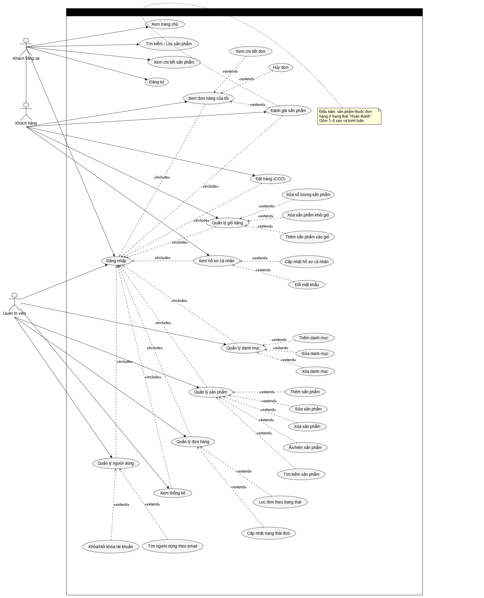

# ĐẶC TẢ YÊU CẦU CHỨC NĂNG (USE CASE SPECIFICATION)

## 0. Sơ đồ Use Case

## 1. Danh sách Tác nhân (Actors)
- **Khách vãng lai (Guest):** Người chưa đăng nhập. Chỉ có quyền xem thông tin.
- **Khách hàng (Customer):** Người đã đăng nhập. Kế thừa quyền của Guest, có quyền mua hàng, quản lý giỏ hàng và tài khoản cá nhân.
- **Quản trị viên (Admin):** Người quản lý hệ thống. Có toàn quyền CRUD dữ liệu, quản lý đơn hàng và người dùng.

---

## 2. ĐẶC TẢ CHI TIẾT CÁC USE CASE (Dành cho Lập trình viên)

### 2.1. NHÓM CHỨC NĂNG KHÁCH VÃNG LAI (GUEST)

#### UC-G1: Xem trang chủ
- **Tác nhân:** Guest, Customer.
- **Mô tả:** Hiển thị giao diện chính với các khối sách mới, sách bán chạy và thanh menu danh mục.
- **Tiền điều kiện:** Không.
- **Luồng chính:**
  1. Người dùng truy cập đường dẫn `/`.
  2. Hệ thống gọi API lấy danh sách 8 sách mới nhất (sắp xếp theo `created_at` giảm dần).
  3. Hệ thống gọi API lấy danh sách danh mục (`categories`) đang hoạt động để hiển thị lên thanh Menu.
  4. Giao diện hiển thị dữ liệu. Hỗ trợ responsive (màn hình 360px đến 1366px).
- **Luồng ngoại lệ:** Mất kết nối API -> Hiển thị khung xương (skeleton loading) hoặc thông báo "Không thể tải dữ liệu, vui lòng F5".

#### UC-G2: Tìm kiếm / Lọc sản phẩm
- **Tác nhân:** Guest, Customer.
- **Mô tả:** Tìm sách theo tên, tác giả hoặc lọc theo danh mục/khoảng giá.
- **Luồng chính:**
  1. Người dùng nhập từ khóa vào ô tìm kiếm (hoặc chọn danh mục, kéo thanh trượt chọn giá).
  2. Hệ thống gọi API `/api/products?keyword=...&category_id=...&min_price=...&max_price=...&sort=...`.
  3. Backend thực hiện câu lệnh SQL `WHERE name LIKE %keyword%` kết hợp các điều kiện lọc.
  4. Trả về kết quả **phân trang (Pagination)** (VD: 12 sản phẩm/trang).
- **Luồng ngoại lệ:** Không tìm thấy kết quả -> Hiển thị màn hình "Không tìm thấy sản phẩm nào phù hợp".

#### UC-G3: Xem chi tiết sản phẩm
- **Tác nhân:** Guest, Customer.
- **Mô tả:** Xem thông tin chi tiết của một cuốn sách.
- **Luồng chính:**
  1. Người dùng click vào một thẻ sản phẩm.
  2. Hệ thống gọi API `/api/products/{id}`.
  3. Hiển thị: Ảnh, Tên, Tác giả, Giá, Mô tả, Số lượng tồn kho (`stock`), Danh mục.
  4. Có nút "Thêm vào giỏ hàng".
- **Luồng ngoại lệ:** Sản phẩm không tồn tại (`id` sai) -> Báo lỗi 404 "Sản phẩm không tồn tại hoặc đã bị ẩn".

#### UC-G4: Đăng ký tài khoản
- **Tác nhân:** Guest.
- **Mô tả:** Tạo tài khoản Khách hàng mới.
- **Luồng chính:**
  1. Người dùng nhập Họ tên, Email, Mật khẩu, Nhập lại mật khẩu.
  2. Frontend validate sơ bộ (định dạng email, mật khẩu >= 8 ký tự).
  3. Gọi API `/api/register`.
  4. Backend kiểm tra: 
     - Validate dữ liệu (NFR-05).
     - Kiểm tra email đã tồn tại trong CSDL chưa (Nếu có -> Báo lỗi "Email đã được sử dụng").
  5. Mã hóa mật khẩu bằng `bcrypt`.
  6. Tạo User mới với `role = 'customer'`, `status = 'active'`.
  7. Trả về thông báo thành công (không tự động đăng nhập, chuyển sang trang Login).

---

### 2.2. NHÓM CHỨC NĂNG KHÁCH HÀNG (CUSTOMER)

> **Lưu ý cho Dev:** Tất cả các API dưới đây đều phải gắn Middleware `auth:sanctum` để kiểm tra đăng nhập.

#### UC-C5: Đăng nhập (Dùng chung cho cả Admin)
- **Tác nhân:** Customer, Admin.
- **Mô tả:** Xác thực người dùng.
- **Luồng chính:**
  1. Người dùng nhập Email, Mật khẩu và nhấn "Đăng nhập".
  2. API `/api/login` kiểm tra email.
  3. Kiểm tra `status`: Nếu `status == 'locked'` -> Báo lỗi "Tài khoản đã bị khóa".
  4. So sánh mật khẩu (Hash check).
  5. Tạo Token (Laravel Sanctum). Trả về Token và thông tin User (`role`).
  6. Frontend lưu Token vào `localStorage`.
  7. **Điều hướng:** Nếu `role == 'admin'` -> chuyển hướng `/admin`. Nếu `role == 'customer'` -> chuyển hướng `/`.

#### UC-C1: Quản lý giỏ hàng
- **Tác nhân:** Customer.
- **Mô tả:** Thêm, sửa, xóa sản phẩm trong giỏ. Chặn vượt tồn kho.
- **Luồng chính (Thêm vào giỏ):**
  1. Tại trang chi tiết sản phẩm, khách nhấn "Thêm vào giỏ".
  2. Frontend kiểm tra `localStorage` có Token không. Nếu không -> Hiển thị popup yêu cầu Đăng nhập.
  3. Gọi API `POST /api/cart/add` (gửi `product_id`, `quantity`).
  4. Backend kiểm tra: Nếu `(Số lượng hiện có trong giỏ + quantity mới) > stock` -> Ném lỗi 400 "Số lượng vượt quá tồn kho".
  5. Nếu hợp lệ, `INSERT` hoặc `UPDATE` bảng `cart_items`.
- **Luồng sửa số lượng:** 
  - Cập nhật trực tiếp ở trang Giỏ hàng. Chặn nhập số âm hoặc vượt quá `stock`.
- **Luồng xóa:** 
  - Xóa bản ghi trong `cart_items`.

#### UC-C2: Đặt hàng (COD)
- **Tác nhân:** Customer.
- **Mô tả:** Chốt đơn hàng từ giỏ hàng.
- **Tiền điều kiện:** Giỏ hàng có ít nhất 1 sản phẩm.
- **Luồng chính:**
  1. Khách nhập Tên, SĐT, Địa chỉ nhận hàng. Nhấn "Đặt hàng".
  2. Backend mở **Database Transaction**.
  3. Kiểm tra lại tồn kho của tất cả sản phẩm trong giỏ một lần nữa. 
  4. Tạo Order mới (`status = 'pending'`, `total_amount = ...`).
  5. Copy dữ liệu từ `cart_items` sang `order_items` (Lưu lại giá tại thời điểm mua vào cột `price`).
  6. Trừ `stock` của bảng `products`.
  7. Xóa sạch giỏ hàng của User.
  8. **Commit Transaction**.
- **Luồng ngoại lệ:** Nếu bước 3 phát hiện có sản phẩm hết hàng -> **Rollback Transaction**, báo lỗi "Sản phẩm X không đủ số lượng".

#### UC-C3: Xem đơn hàng của tôi
- **Tác nhân:** Customer.
- **Mô tả:** Xem danh sách và chi tiết đơn hàng.
- **Luồng chính:**
  - Gọi API `GET /api/orders`. Backend chỉ `SELECT` các order có `user_id = Auth::id()` (Chặn xem đơn người khác - TM-NFR4).
- **Luồng Hủy đơn:**
  - Khách nhấn "Hủy đơn".
  - Backend kiểm tra: Chỉ cho phép hủy khi `status == 'pending'`.
  - Nếu hợp lệ: Chuyển `status = 'cancelled'` và **cộng lại `stock`** cho sản phẩm.

#### UC-C4: Xem hồ sơ cá nhân & Cập nhật
- **Tác nhân:** Customer.
- **Luồng chính:**
  - Hiển thị thông tin: Username, Email, SĐT, Địa chỉ, Ảnh đại diện.
- **Luồng cập nhật thông tin:**
  - Sửa Họ tên, SĐT. API `PUT /api/profile`.
- **Luồng cập nhật địa chỉ (Nâng cao):**
  - Sử dụng Dropdown 3 cấp gọi API của `provinces.open-api.vn` để lấy Tỉnh/Thành, Quận/Huyện, Phường/Xã. Kết hợp ô nhập Số nhà để tự động ghép thành 1 chuỗi địa chỉ hoàn chỉnh trước khi lưu vào CSDL.
- **Luồng upload ảnh (Nâng cao):**
  - Upload file ảnh (validate định dạng Image, <2MB). Backend lưu vào thư mục `public/avatars`, trả về URL và cập nhật cột `image_path`.
- **Luồng đổi mật khẩu:**
  - Bắt buộc nhập Mật khẩu cũ (để xác thực) + Mật khẩu mới (>=8 ký tự) + Nhập lại mật khẩu mới. API `PUT /api/profile/change-password`.

#### UC-C6: Đánh giá sản phẩm (Mức C)
- **Tác nhân:** Customer.
- **Luồng chính:**
  - Khách xem đơn hàng có trạng thái `completed` (Hoàn thành).
  - Cạnh mỗi sản phẩm có nút "Đánh giá".
  - Khách chọn 1-5 sao và nhập bình luận.
  - Hệ thống lưu vào bảng `reviews` (chỉ lưu 1 lần cho 1 sản phẩm trong 1 đơn).

---

### 2.3. NHÓM CHỨC NĂNG QUẢN TRỊ VIÊN (ADMIN)

> **Lưu ý cho Dev:** Tất cả API dưới đây phải gắn Middleware `auth:sanctum` + Middleware kiểm tra quyền Admin.

#### UC-A1: Quản lý danh mục
- **Tác nhân:** Admin.
- **Luồng chính:**
  - **Xem (Read):** Lấy danh sách danh mục.
  - **Thêm/Sửa (Create/Update):** Nhập tên danh mục. Validate không được trùng tên.
  - **Xóa (Delete):** Kiểm tra xem danh mục đó có chứa sản phẩm nào không (`products.category_id`). Nếu có -> Báo lỗi "Không thể xóa danh mục đang có sản phẩm".

#### UC-A2: Quản lý sản phẩm
- **Tác nhân:** Admin.
- **Luồng chính:**
  - **Xem:** Danh sách sản phẩm (có phân trang server, tìm kiếm theo tên).
  - **Thêm mới:**
    - Upload 1 ảnh (chặn file > 2MB, chỉ nhận JPG/PNG).
    - Nhập Tên, Giá, Số lượng, Mô tả, Danh mục.
  - **Sửa:** Cập nhật thông tin. Có thể thay đổi ảnh.
  - **Ẩn/Hiện:** Thay đổi trạng thái `status` của sản phẩm (active/hidden) để ẩn khỏi trang khách hàng.
  - **Xóa:** Nếu sản phẩm đã từng nằm trong đơn hàng -> Chuyển sang Xóa mềm (`is_deleted = 1`). Nếu chưa -> Xóa cứng.

#### UC-A3: Quản lý đơn hàng
- **Tác nhân:** Admin.
- **Luồng chính:**
  - **Xem danh sách:** Lọc theo trạng thái đơn (`pending`, `shipping`, `completed`, `cancelled`).
  - **Cập nhật trạng thái:** 
    - Từ `pending` -> `shipping` (Đang giao).
    - Từ `shipping` -> `completed` (Hoàn thành).
    - Từ `pending` -> `cancelled` (Hủy).
    - **Ràng buộc:** Không được chuyển trạng thái đi lùi (VD: Từ `completed` không được quay lại `pending`).

#### UC-A4: Quản lý người dùng
- **Tác nhân:** Admin.
- **Luồng chính:**
  - **Xem danh sách:** Tìm kiếm theo email.
  - **Khóa/Mở khóa:** Toggle trạng thái `status` giữa `active` và `locked`. (Nếu `locked` thì API Login sẽ chặn lại). Không cho phép Admin tự khóa tài khoản của chính mình.

#### UC-A5: Xem thống kê (Mức C)
- **Tác nhân:** Admin.
- **Luồng chính:**
  - Gọi API trả về: Tổng doanh thu (tính tổng `total_amount` của đơn `completed`), Top 5 sản phẩm bán chạy, Số lượng đơn hàng theo từng trạng thái.
  - Giao diện Frontend vẽ biểu đồ (sử dụng thư viện như Chart.js hoặc Recharts).

  #### UC-C3: Xem đơn hàng của tôi
- **Tác nhân:** Customer.
- **Mô tả:** Xem danh sách và chi tiết đơn hàng.
- **Luồng chính:**
  - Gọi API `GET /api/orders`. Backend sử dụng `paginate(10)` để phân trang. Chỉ `SELECT` các order có `user_id = Auth::id()` (Chặn xem đơn người khác - TM-NFR4).
- **Luồng Hủy đơn:**
  - Khách nhấn "Hủy đơn".
  - Backend kiểm tra: Chỉ cho phép hủy khi `status == 'pending'`.
  - Nếu hợp lệ: Chuyển `status = 'cancelled'` và dùng DB Transaction để **cộng lại `stock`** cho tất cả sản phẩm trong đơn đó.